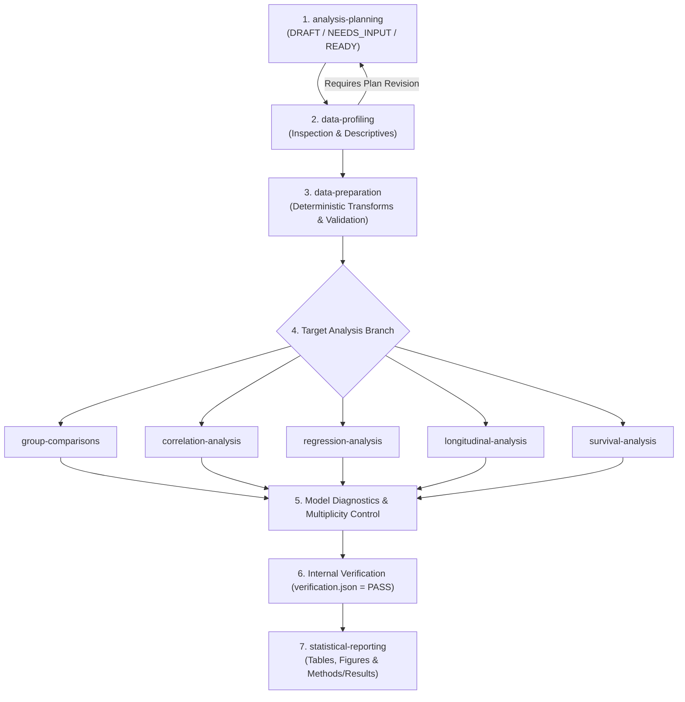

# BioStat Agent Skills for Google Antigravity

An auditable, reproducible, and modular suite of **9 specialized Agent Skills** designed to orchestrate end-to-end biostatistical analysis pipelines with rigorous methodological standards.

This repository covers the complete analytical lifecycle: from study design and formal analysis planning to exploratory data profiling, deterministic data preparation, classical and advanced statistical modeling, and publication-ready reporting.

---

## 🎯 Purpose & Principles

Modern clinical, epidemiological, and biomedical research demands high analytical rigor, systematic assumption verification, transparent diagnostic auditing, and full computational reproducibility.

**BioStat Agent Skills** are engineered around core design principles:
1. **Strict Methodological Separation:** Distinct skills manage each specialized analytical family. Each analysis skill executes its own assumption assessment, method-specific diagnostics, and independent numerical verification.
2. **Offline & Privacy-First Execution:** Research data are treated strictly as data, never as executable code or external prompts. All numerical calculations execute locally in R; external network access is disabled during offline analysis.
3. **Evidence-Based Gating:** Progression across workflow stages is controlled by formal status gates (`READY`, `COMPLETE`, `PASS`). Unresolved critical violations or unverified computations immediately block downstream inference and reporting.
4. **Independent Numerical Verification (`verification.json`):** Every result-producing skill re-computes key quantities, validates tolerance thresholds, checks CI bounds and effect-scale identities, and matches data/code hashes before release.

---

## 🧩 The 9 Skills & Scopes

| Skill Name | Directory | Scope and Responsibilities |
| :--- | :--- | :--- |
| **analysis-planning** | [`analysis-planning/`](./analysis-planning/SKILL.md) | Translates research questions, study design, observational units, target estimands, dependence structures, covariate choices, and testing families into an auditable analysis plan (`analysis_plan.json`). |
| **data-profiling** | [`data-profiling/`](./data-profiling/SKILL.md) | Non-destructive source data inspection: variable types, missingness patterns, category frequencies, numeric distribution metrics, units, and optional CDISC standards-readiness screening. |
| **data-preparation** | [`data-preparation/`](./data-preparation/SKILL.md) | Reproducible deterministic recoding, variable derivations, verified unit conversions, joins, and reshaping (`analysis_data.rds`). Verifies row counts, type stability, and observed-value preservation. |
| **group-comparisons** | [`group-comparisons/`](./group-comparisons/SKILL.md) | Compares independent or paired groups (Welch/Student t, ANOVA, Mann-Whitney, Kruskal-Wallis, Chi-square, Fisher exact, McNemar). Computes standardized effect sizes and governs shared multiplicity protocols. |
| **correlation-analysis** | [`correlation-analysis/`](./correlation-analysis/SKILL.md) | Estimates Pearson, Spearman, and covariate-adjusted partial correlations with justified confidence intervals, robust bootstrap options, and association visualizations. |
| **regression-analysis** | [`regression-analysis/`](./regression-analysis/SKILL.md) | Fits and evaluates linear, binary logistic, ordinal (proportional odds), and count (Poisson, negative binomial) regression models for independent observations, with multicollinearity and influence diagnostics. |
| **longitudinal-analysis** | [`longitudinal-analysis/`](./longitudinal-analysis/SKILL.md) | Models repeated measures and clustered data using Linear Mixed Models (LMM), Generalized Linear Mixed Models (GLMM), MMRM, and Generalized Estimating Equations (GEE), with structured covariance assessment. |
| **survival-analysis** | [`survival-analysis/`](./survival-analysis/SKILL.md) | Analyzes right-censored time-to-event outcomes: Kaplan-Meier estimation, log-rank tests, Cox proportional hazards regression, Schoenfeld residual diagnostics, and justified Restricted Mean Survival Time (RMST). |
| **statistical-reporting** | [`statistical-reporting/`](./statistical-reporting/SKILL.md) | Generates publication-ready tables, figures, and Methods/Results manuscripts exclusively from verified results (`verification.json: PASS`), performing cross-matching and claim-to-source consistency audits. |

---

## 🚀 Usage in Google Antigravity

Antigravity operates with a **Progressive Disclosure** architecture:

1. **Indexing & Discovery:** Upon startup, Antigravity reads only the YAML frontmatter (`name` and `description`) of each `SKILL.md` file. The full instructions remain out of context until explicitly needed.
2. **On-Demand Activation:** When an instruction or user prompt requires a specific procedure (e.g., *"Fit a Cox proportional hazards model and inspect Schoenfeld residuals"*), Antigravity detects the corresponding skill (`survival-analysis`) and loads its instructions into the execution context.

### Setup & Installation

#### Option 1: Workspace / Project-Level (Recommended)
Place the skill directories into your project repository under `.agents/skills/`:
```bash
my-biostat-project/
├── .agents/
│   └── skills/
│       ├── analysis-planning/
│       │   └── SKILL.md
│       ├── data-profiling/
│       │   └── SKILL.md
│       ├── data-preparation/
│       │   └── SKILL.md
│       ├── group-comparisons/
│       │   └── SKILL.md
│       ├── correlation-analysis/
│       │   └── SKILL.md
│       ├── regression-analysis/
│       │   └── SKILL.md
│       ├── longitudinal-analysis/
│       │   └── SKILL.md
│       ├── survival-analysis/
│       │   └── SKILL.md
│       └── statistical-reporting/
│           └── SKILL.md
├── data/
│   └── raw/
└── analysis/
```

#### Option 2: Global User Configuration
Add the skills to your global Antigravity configuration directory (`~/.gemini/antigravity/skills/` or `~/.gemini/config/skills/`) to make them universally accessible across all workspaces.

---

## ⚙️ Workflow & Gating Architecture



### Gate Rules
- **Planning Gate:** No inferential calculation or hypothesis test can begin until `analysis_plan.json` achieves `READY` status.
- **Preparation Gate:** Deterministic preparation status must be `COMPLETE` before model fitting.
- **Verification Gate:** Every reported result must have an accompanying `verification.json` artifact with `PASS` status and matching code/data hashes. Unperformed critical checks or numerical discrepancies immediately set `BLOCKED` or `FAIL`.
- **Reporting Gate:** The reporting skill performs no new statistical calculations; it acts as an auditable bridge between verified artifacts and scientific manuscripts.
