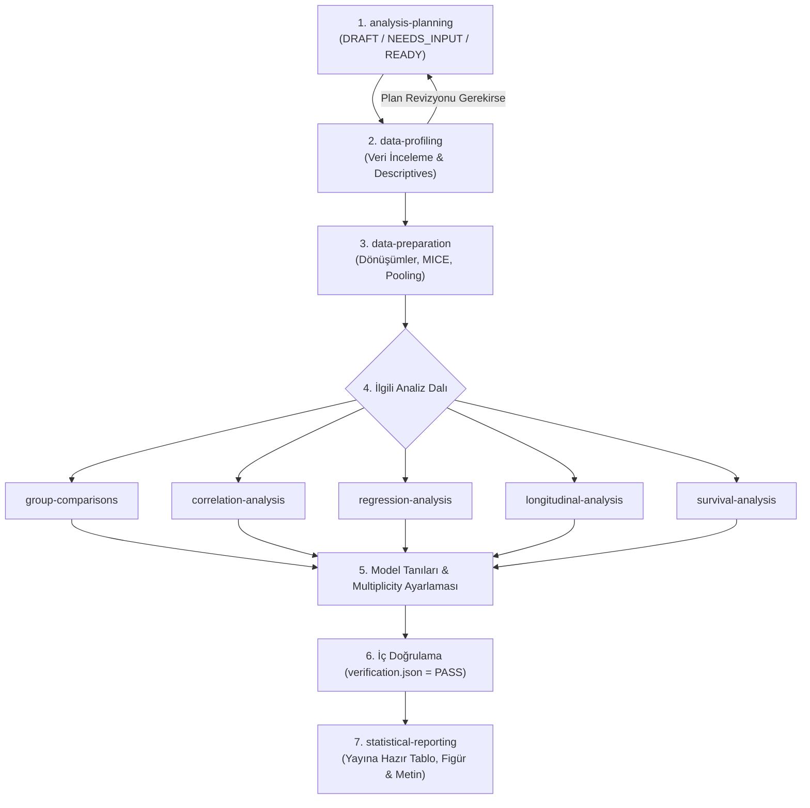

# BioStat Agent Skills for Google Antigravity

Biyoistatistik analiz süreçlerini uçtan uca, yüksek metodolojik standartlarda, denetlenebilir ve tekrarlanabilir bir şekilde yürüten **9 modüler Agent Becerisi (Skill)** paketi.

Bu repo; araştırma planlamasından veri profillemeye, veri hazırlığından karmaşık istatistiksel modellemelere ve yayına hazır raporlamaya kadar uzanan biyoistatistik iş akışını yönetmek üzere tasarlanmıştır.

---

## 🎯 Projenin Amacı

Modern klinik, epidemiyolojik ve biyomedikal araştırmalarda istatistiksel analizlerin geçerliliği; doğru çalışma tasarımına, titiz varsayım kontrollerine, şeffaf model tanılarına ve tam tekrarlanabilirliğe bağlıdır.

**BioStat Agent Skills** projesinin amaçları:
1. **Katı Metodolojik Ayrım:** Analiz adımlarını uzmanlaşmış 9 beceriye bölerek her aşamanın kendi varsayım kontrollerini ve bağımsız sayısal doğrulamasını yapmasını sağlamak.
2. **Offline & Gizlilik Öncelikli (Privacy-First):** Veri dosyalarını asla model belleğinde komut olarak yürütmemek, tüm sayısal hesaplamaları yerel R oturumunda gerçekleştirmek ve dış ağ bağlantısı olmaksızın çevrimdışı çalışmak.
3. **Denetlenebilirlik ve Kapı Kuralları (Gating):** Bir sonraki adıma geçişi kanıta dayalı durum bayraklarına (`READY`, `COMPLETE`, `PASS`) bağlamak; kritik bir hata veya tanısal uyarı varken analizi veya raporlamayı engellemek.
4. **Bağımsız Doğrulama (`verification.json`):** Sonuç üreten her analiz becerisinin, bağımsız yeniden hesaplama, tolerans kontrolü ve veri/kod hash eşleştirmesi ile kendi doğrulama dosyasını üretmesi.

---

## 🧩 9 Skill ve Sorumluluk Alanları

| Skill Adı | Klasör | Sorumluluk ve Kapsam |
| :--- | :--- | :--- |
| **analysis-planning** | [`analysis-planning/`](./analysis-planning/SKILL.md) | Araştırma sorusu, çalışma tasarımı, hedef estimand, bağımlılık yapısı, eksik veri stratejisi ve test ailelerinin denetlenebilir bir plana (`analysis_plan.json`) dönüştürülmesi. |
| **data-profiling** | [`data-profiling/`](./data-profiling/SKILL.md) | Kaynak veriye müdahale etmeden değişken tipleri, eksiklik örüntüleri, birimler, kategorik dağılımlar ve özet istatistiklerin incelenmesi; opsiyonel CDISC uyumluluk ön taraması. |
| **data-preparation** | [`data-preparation/`](./data-preparation/SKILL.md) | Onaylanmış deterministik recoding, birim çevrimleri, türetilmiş değişkenler ve MICE ile çoklu atama (multiple imputation), pooling (Rubin kuralları) ve tipping-point duyarlılık analizi. |
| **group-comparisons** | [`group-comparisons/`](./group-comparisons/SKILL.md) | İki veya çoklu bağımsız/eşleştirilmiş grupların karşılaştırılması (Welch t, ANOVA, Mann-Whitney, Kruskal-Wallis, ki-kare, Fisher, McNemar); standartlaştırılmış etki büyüklükleri ve ortak multiplicity protokolü. |
| **correlation-analysis** | [`correlation-analysis/`](./correlation-analysis/SKILL.md) | Pearson, Spearman ve kovaryat düzeltmeli kısmi (partial) korelasyon analizleri, robust bootstrap aralıkları ve ilişki görselleştirmeleri. |
| **regression-analysis** | [`regression-analysis/`](./regression-analysis/SKILL.md) | Bağımsız gözlemler için Doğrusal, İkili Lojistik, Ordinal (proportional odds) ve Sayım (Poisson, Negatif Binom, ZIP, hurdle) regresyon modelleri; collinearity, ayrılma (separation) ve etki tanıları. |
| **longitudinal-analysis** | [`longitudinal-analysis/`](./longitudinal-analysis/SKILL.md) | Bağımlı, tekrarlı ölçümler ve kümelenmiş veriler için Doğrusal Karma Modeller (LMM), Genelleştirilmiş Doğrusal Karma Modeller (GLMM), MMRM ve Marjinal Modeller (GEE); kovaryans yapısı modellemesi. |
| **survival-analysis** | [`survival-analysis/`](./survival-analysis/SKILL.md) | Sağdan sansürlü zaman-olay verileri için Kaplan-Meier eğrileri, log-rank testleri, Cox orantılı hazards modelleri, Schoenfeld artık tanıları ve gerekçelendirilmiş Sınırlı Ortalama Sağkalım Süresi (RMST). |
| **statistical-reporting** | [`statistical-reporting/`](./statistical-reporting/SKILL.md) | Doğrulanmış (`verification.json: PASS`) analiz çıktılarından yayına hazır tablolar, grafikler, Yöntemler ve Bulgular metinlerinin oluşturulması; iddia-veri tutarlılık denetimi. |

---

## 🚀 Antigravity İçinde Kullanım

Antigravity, Agent becerilerini **Aşamalı İfşa (Progressive Disclosure)** mimarisiyle çalıştırır:

1. **İndeksleme:** Antigravity başlatıldığında her `SKILL.md` dosyasının yalnızca başındaki YAML frontmatter (`name` ve `description`) okunur ve agent'ın yetenek dizinine eklenir. Context penceresi gereksiz metinlerle doldurulmaz.
2. **Aktivasyon:** Kullanıcı bir talepte bulunduğunda (örneğin *"Grup karşılaştırmalarını yap ve varsayımları kontrol et"*), Antigravity ilgili beceriyi (`group-comparisons`) otomatik olarak algılar ve yalnızca o becerinin yönergelerini bağlama yükler.

### Kurulum Yolları

#### 1. Proje Düzeyinde Kullanım (Önerilen)
Skill klasörlerini mevcut projenizin `.agents/skills/` dizinine yerleştirin:
```bash
my-biostat-project/
├── .agents/
│   └── skills/
│       ├── analysis-planning/
│       │   └── SKILL.md
│       ├── data-profiling/
│       │   └── SKILL.md
│       ├── data-preparation/
│       │   └── SKILL.md
│       ├── group-comparisons/
│       │   └── SKILL.md
│       ├── correlation-analysis/
│       │   └── SKILL.md
│       ├── regression-analysis/
│       │   └── SKILL.md
│       ├── longitudinal-analysis/
│       │   └── SKILL.md
│       ├── survival-analysis/
│       │   └── SKILL.md
│       └── statistical-reporting/
│           └── SKILL.md
├── data/
│   └── raw/
└── analysis/
```

#### 2. Global Kullanıcı Düzeyinde Kullanım
Becerileri Antigravity'nin global yapılandırma dizinine (`~/.gemini/antigravity/skills/` veya `~/.gemini/config/skills/`) ekleyerek tüm çalışma alanlarınızda doğrudan erişilebilir kılabilirsiniz.

---

## ⚙️ İş Akışı ve Yürütme Sırası (Workflow & Gating)



### Kapı (Gate) Kuralları
- **Plan Kapısı:** `analysis_plan.json` durumu `READY` olmadan hiçbir çıkarımsal analiz (p değeri, kestirim) başlatılamaz.
- **Hazırlık Kapısı:** Deterministik veri hazırlığı `COMPLETE` olmadan model uydurulamaz.
- **Çoklu Atama (MI) Kapısı:** MICE uydurması tamamlanmış veri kümelerinde başlasa da, nihai çıkarım ancak Rubin kurallarıyla birleştirme (pooling) ve duyarlılık adımları başarıyla tamamlandığında serbest kalır.
- **Raporlama Kapısı:** Raporlanan her analiz çıktısının sahibinden hash eşleşmeli `verification.json` dosyası ve `PASS` sonucu bulunmalıdır. Eksik kritik kontrol raporlamayı engeller (`BLOCKED`).

---

## 🔒 Gizlilik ve Güvenilirlik İlkeleri

- **Veri Güvenliği:** Araştırma verileri kesinlikle yerel ortamda tutulur; dış ağ erişimi kapalıdır.
- **R & Python Ayrımı:** İstatistiksel ve biyometrik tüm hesaplamalar R betikleri (`analysis.R`, `preparation.R` vb.) ile yürütülür; dosya yönetimi ve yardımcı araçlar için Python kullanılır.
- **Asla Uydurma / Değiştirme Yapılmaz:** Anlamlılık (p < 0.05) elde etmek için modeller, dışlama kriterleri veya dönüştürmeler asla sonradan değiştirilemez.
